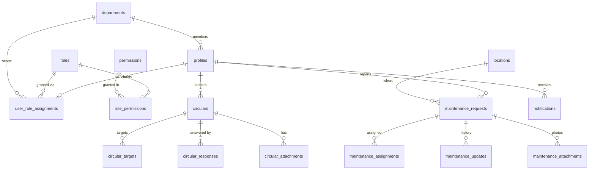

# Database Redesign — Single School, Owner-Managed Roles

**Status:** Draft v2. Decisions D1–D14 approved on 2026-11-04. Section 4.6 (public/private visibility) is new and awaiting your answers. **No code, migration or UI file has been changed.**
**Date:** 2026-11-04
**Companion document:** `RBAC_Roles.md` (roles, permission matrix, open role questions).

Tags: **[Verified]** read in the repo · **[Proposed]** recommendation · **[Assumption]** my default, change it if wrong · **[Decision]** needs your answer.

---

## 1. Goals

1. One school per deployment, with a single set of school settings.
2. The Platform Owner stays exactly as it is today (hidden from non-owners, exclusive backup/restore and achievements).
3. Hybrid roles: five locked system roles plus owner-created custom roles; the owner edits every role's permissions with no code change.
4. A clean, professional schema that is easy to understand and to implement, built fresh (no data to migrate).
5. Keep the UI as it is. UI files are edited only when unavoidable, and each such edit is listed here for approval (section 8).

---

## 2. What the current schema costs us

| Fact | Evidence |
|---|---|
| 26 tables, 22 of them carry `school_id` (the others are `schools`, `permissions`, `role_permissions`, `system_settings`) | [Verified] migrations `0003`–`0007`, `0028`–`0053` |
| 66 migrations, many of them patches: policy repairs, hand-drift corrections, backup function rewrites | [Verified] `0014`–`0065` |
| Database drifted from the migrations by hand in production (auditor deleted, `roles.manage` removed, owner permissions added) | [Verified] `0059`, `0060`, `0061` |
| `school_id` appears in 51 action files, 124 `lib` files, 24 route pages and 2 components (tests excluded) | [Verified] grep of `src` |
| Role/permission logic carries tenant branches: platform-level assignment = `school_id` null, per-school custom roles, per-school unique indexes | [Verified] `0003`, `0020`, `0040` |
| Permission catalog is copied by hand in three places (SQL seed, `permissions.ts`, `permissionCatalog.ts`) | [Verified] |

Removing multi-tenancy deletes a whole class of policies, triggers and parameters. That is where most of the simplification comes from.

---

## 3. Core decision: how to remove `school_id`

This is the choice that sets the size of the work.

| | **Option A: clean removal (recommended)** | **Option B: singleton shim** |
|---|---|---|
| Idea | Drop `school_id` from every table, policy, function and query | Keep `school_id` columns, but only one `schools` row can exist and every row points at it |
| Database result | Clean, no tenant concepts left | Still looks multi-tenant; policies keep tenant joins |
| Code change | Mechanical but wide: about 200 files lose a parameter or a filter | Almost none |
| UI files touched | Some route pages and 2 components (parameter removal only) | None |
| Long-term cost | Low | Permanent confusion and extra joins |
| Risk | Medium, mitigated by the existing test suite and a compiler-guided sweep | Low now, high later |

**Recommendation: A**, done in phases (section 9) so the app is verified after each module. B is acceptable only if you need the UI byte-for-byte unchanged right now.

**[Decision D1]** A or B?

**[Assumption]** Table and column names stay as they are, except `school_id` (removed under A). Under A, `schools` and `school_settings` stay as **single-row tables** so the existing code and screens that read them keep working.

---

## 4. Target schema (Option A)

Conventions: UUID primary keys, `timestamptz`, `created_at` / `updated_at` on every table, `is_active` for soft disable, enums for closed sets (kept from `0002`).

### 4.1 School

| Table | Change |
|---|---|
| `schools` | Single row, enforced by a `singleton boolean default true unique check (singleton)` column. Keeps all current profile columns (names, logo, phone, email, manager and assistant names, address, vision, mission). **`timezone` is removed** (decided): only three read-only `lib` files select it today (`getCurrentSchool`, `getSchoolFullDetails`, `getPublicSchoolProfile`) plus the public profile view, and no screen edits it. `slug` is **kept**: the school identity form in Settings edits it, so dropping it would force a UI change. It stays unique, which is trivially true with one row. |
| `school_settings` | Single row (primary key `singleton boolean`). Keeps academic year, working days, locale, date format, policies. **Working days are selected by the school** (the Operations tab and the calendar validation already work this way); the seeded blank row starts with Sunday–Thursday until someone changes it. |
| `system_settings` | Unchanged. |
| `school_sequences` → keeps its name | Primary key becomes `(kind, year)`; numbering for circulars and tickets no longer depends on a school. |

### 4.2 People and organization

| Table | Change |
|---|---|
| `departments` | Drop `school_id`. Keeps `head_profile_id`. |
| `locations` | Drop `school_id`. |
| `profiles` | Drop `school_id`. Keeps `department_id`, `is_active`, `last_seen_at`. |

### 4.3 Roles and permissions (new shape)

| Table | Columns |
|---|---|
| `permissions` | `key` (PK), `category`, **`name_ar`, `name_en`, `description`, `sort_order`** (labels move from `permissionCatalog.ts` into the database; one source of truth) |
| `roles` | `id`, `key` (unique), `name_ar`, `name_en`, `is_system`, **`is_locked`** (true for `owner`: permissions cannot be edited), `created_at`, `updated_at` |
| `role_permissions` | `(role_id, permission_key)` primary key. Unchanged shape. |
| `user_role_assignments` | `id`, `user_id`, `role_id`, `department_id`, `assigned_by`. **Unique on `user_id`: one role per user** [Assumption]. No `school_id`. |

Notes:

- **The owner decides every role's permissions (decided).** The baseline seeds the five system roles with **no permission grants at all**. The only exception is the locked `owner` role, which holds everything implicitly. Nothing in the code or the database may assume that a role such as `school_admin` has a particular permission.
- **Owner has every permission automatically**: `has_permission` returns true for any key when the caller holds the locked `owner` role, so a newly added permission can never be missing for the owner. No stored rows needed for it.
- The owner is a normal assignment of the `owner` role, not a special "platform-level" row.
- The `name` column becomes `name_ar` / `name_en` only if the role screens already use two languages; otherwise it stays `name` **[Decision D2: do the existing role screens need bilingual role names?]**.

### 4.4 Circulars, maintenance, calendar, platform

All keep their current columns, with `school_id` removed and the unique constraints simplified:

| Table | Unique constraint change |
|---|---|
| `circulars` | `unique (ref_number)` |
| `maintenance_requests` | `unique (ticket_number)` |

Other tables with `school_id` removed: `circular_targets`, `circular_responses`, `circular_attachments`, `maintenance_assignments`, `maintenance_updates`, `maintenance_attachments`, `calendar_events`, `notifications`, `audit_logs`, `file_metadata`, `backup_snapshots`, `school_achievements`, `school_documents`.

### 4.5 Relationship overview



### 4.6 Public / private visibility (new)

**What exists today [Verified]:** the idea is already in the schema, but it is built three different ways, and it has been patched repeatedly (`0055`, `0063`, `0064`, `0065`; `0064` fixed a mismatch between `'all'` and `'public'`).

| Table | Today |
|---|---|
| `calendar_events` | enum `calendar_visibility` (`public` / `internal`) |
| `circulars` | text column with a check (`public` / `internal`) |
| `school_achievements` | text column with a check (`public` / `internal`) |
| `school_documents` | boolean `is_published` |
| `maintenance_requests` | none (never public) |

**[Proposed]** one shared enum, used the same way everywhere:

```
create type content_visibility as enum ('public', 'internal');
-- column: visibility content_visibility not null default 'internal'
```

- **Default is `internal` (private).** Nothing becomes public unless its creator chooses it.
- A single enum instead of two booleans (`is_general` / `is_private`): two flags can contradict each other, one value cannot.
- **Public** = visible to anonymous visitors and all signed-in users, but only when the item is also published (`status = 'published'`).
- **Internal** = visible only to authorised users (for circulars: the targeted departments and the people who manage them).
- Attachments inherit the visibility of their parent item.
- Anonymous visitors never receive personal data: no author identity, no responses, no reporter details. Public pages read from dedicated public views or policies that expose a fixed list of columns.
- Only users holding the item's publish permission can set `public` (for circulars `circular.publish`, for calendar `calendar.manage`, and so on). Everyone else's items are forced to `internal` by the database, not just hidden in the form.
- `school_documents.is_published` is replaced by `status` + `visibility`, so documents follow the same rule as everything else.
- **Maintenance requests stay always private.** They contain reporter names, rooms and photos, and I don't see a reason to publish them. This is **[Decision D8]**.

Result: one rule, one policy pattern, one test for every public/private table, instead of four.

---

## 5. Roles and permissions design

### 5.1 What the owner can do with no code change

1. Create, rename and delete custom roles.
2. Add or remove any permission on any role, including the five system roles (not the locked owner role).
3. Assign a role to a user.

### 5.2 Rules, enforced in the database

| Rule | Mechanism |
|---|---|
| Only the owner may insert, update or delete `roles` and `role_permissions` | RLS + trigger |
| System roles cannot be deleted | Trigger |
| A role that still has users cannot be deleted (**Q11, decided**) | Trigger |
| The `owner` role is locked: its permissions and key cannot change | `is_locked` + trigger |
| Only an owner can assign or keep the `owner` role | RLS + trigger |
| The last owner cannot be removed, demoted or deactivated | Trigger |
| A user cannot change their own role | Trigger |
| Every change to `roles`, `role_permissions` or assignments is written to `audit_logs` | Trigger |

The previous "last school administrator" guard is **removed**: it depended on a role key, which conflicts with owner-controlled roles, and the permanent owner makes it unnecessary.

### 5.3 Immediate effect (**Q12, decided**)

Permissions are evaluated in the database on every request (`has_permission`, `effective_permission_keys`). They are not copied into the login token, so a change applies immediately to users who are already signed in. The existing live-notification channel can optionally nudge open sessions to refresh.

### 5.4 Permission check

```
has_permission(key text, department uuid default null) returns boolean
```

- Caller must be active.
- Owner role → true.
- Otherwise the caller's role must hold `key`.
- If a department is requested, the caller's assignment must match it or be department-free (a school-wide role).

One parameter fewer than today (`school` goes away).

### 5.5 Code that must stop checking role names

So that custom roles work everywhere, these move from "role key is X" to "role has permission Y". [Verified in code]

| Today | Becomes |
|---|---|
| Technician list = users with role key `operator` (decision D19) | Users whose role has `maintenance.update` |
| `assignUserRole` hard-coded list of school-wide role keys (includes retired `auditor`) | Driven by whether the role needs a department (a flag on the role) |
| `resolveRoleDisplayName` switch on role keys | Reads the role's stored name; keeps translations for the five system roles |

**Other places that check role keys today and must be converted or removed** (found by grep, non-test files): `RoleTableActions.tsx` (UI), `validateCreateUserInput.ts`, `assertCanDeleteRoleRecord.ts`, `validateCreateRoleInput.ts`, `toSchoolUserRow.ts`, `verifyManageTargetUser.ts`, `mapSchoolUserRows.ts`, `getMaintenanceOperators.ts`. Checks for the fixed `owner` role stay, because the owner is a fixed, locked role. Everything else becomes a permission check or a role flag.

**[Decision D3, approved]** Add a `requires_department` boolean to `roles` (true for `department_head`, optional for custom roles)? I recommend yes.

### 5.6 Permission catalog

Start from the 16 current keys, then add the extra keys proposed in `RBAC_Roles.md` §7.2 only where a screen or policy will enforce them. Any key without enforcement is just a label, so I'd add keys together with the code that uses them, not ahead of it. The owner cannot invent new keys; a developer adds a key with its policy and screen.

---

## 6. Row-level security design

Principle: **deny by default, enforce in the database, one pattern per table.**

| Pattern | Used for |
|---|---|
| Permission only | `departments`, `locations`, `school_settings`, `calendar_events` writes |
| Permission + department scope | `circular_responses` (respond for own department), department views |
| Permission + ownership | `maintenance_requests` (reporter sees own), `notifications` (own) |
| Permission + assignment | `maintenance_updates` (assigned technician) |
| Owner only | `roles`, `role_permissions`, backups, achievements |

With tenants gone, every policy shrinks: no `school_id = ...` joins, no per-school branches, no platform-level special case. The known-bug class from `0049` (self-comparing `ura.school_id = school_id`) cannot recur.

---

## 7. Migrations and tooling

- Replace the 66 migrations with a **fresh baseline** split by concern, in order:
  1. extensions and enums
  2. tables and indexes
  3. functions and triggers
  4. RLS policies
  5. storage buckets and storage policies
  6. seed data: permissions, the five system roles and their default grants
- `supabase/seed.sql` (demo users) is updated to match.
- Backup/restore functions (`0042`, `0043`) and the Zod backup schema are rewritten without school scoping.
- The RLS test harness (`supabase/tests/phase11.rbac.test.mjs`, `npm run test:rls`) is rewritten around the new roles, and gains tests for every rule in 5.2.
- Applies to both local Supabase CLI and the hosted project; hosted gets a clean reset **[Assumption: nothing there must be kept]**.

---

## 8. Application impact

| Area | Files with `school_id` (non-test) | Nature of change |
|---|---|---|
| `src/lib` | 124 | Remove the school parameter and filters; simplify `hasPermission`, `getEffectivePermissions`, `getSchoolRoles` |
| `src/actions` | 51 | Remove school resolution (`resolveSchoolForCaller` and similar) |
| `src/app` route pages | 24 | **UI-adjacent:** mechanical removal of school-id plumbing only |
| `src/components` | 2 | **UI:** `BackupExportCard.tsx`, `SchoolProfileForm.tsx`, mechanical only |
| Tests | many | Updated alongside |

**UI rule:** under Option A the only UI-adjacent edits are the 24 pages and 2 components above, and only to delete school-id plumbing. No layout, text, styling or behaviour changes. If a screen needs more than that, I stop and ask. I will list every UI file I intend to touch before touching it.

---

## 9. Implementation phases

Each phase ends green: `npm run verify` (lint, typecheck, tests) and the RLS harness.

| Phase | Work | Exit check |
|---|---|---|
| 0 | Approve this document and `RBAC_Roles.md` | Your sign-off |
| 1 | New baseline schema + seed on local Supabase | Schema applies cleanly; seed loads |
| 2 | RLS, triggers, role rules (5.2) + new RLS test harness | All role rules covered by passing tests |
| 3 | Data layer: `lib/rbac`, `lib/school`, `lib/auth`, role actions | Typecheck + unit tests |
| 4 | Modules one at a time: circulars → maintenance → calendar → settings → reports → documents → achievements | Tests per module |
| 5 | Backup/restore rewrite | Export/restore round trip test |
| 6 | Pages and the 2 components (school-id removal only) | Full verify + Playwright e2e |
| 7 | Docs: README, manuals, `RBAC_Roles.md`, `decisions.md` updated to match | Docs match the code (repo Rule #13) |

---

## 10. Risks

| Risk | Mitigation |
|---|---|
| Wide mechanical change (about 200 files) | Phases, typecheck as a guide, existing 651 tests |
| Policies written fresh could leave a hole | New RLS harness tests every role against every table, plus the rule tests in 5.2 |
| Owner-editable permissions could lock people out | Locked owner role, last-admin guard, audit trail |
| A custom role granted a permission nothing enforces | Catalog only contains enforced keys |
| README claims (651 vs 253 tests, six roles) are already inconsistent | Fixed in phase 7 |

---

## 11. Decisions

D1–D7 are **approved** (all recommendations accepted on 2026-11-04). D8–D14 are approved too (2026-11-04).

| # | Decision | My recommendation |
|---|---|---|
| D1 | Option A (clean removal) or B (singleton shim)? | **A** |
| D2 | Bilingual role names (`name_ar` / `name_en`) or keep one `name`? | Bilingual, if the role screens already show both languages |
| D3 | Add `requires_department` flag on roles? | Yes |
| D4 | One role per user? | Yes (simplest; matches today's role-key resolution) |
| D5 | Keep `schools` and `school_settings` as single-row tables (keeps names, fewer code changes)? | Yes |
| D6 | Fresh baseline replaces all 66 migrations, including on the hosted project? | Yes |
| D7 | Add new permission keys only together with their enforcing code? | Yes |
| D8 (approved) | Which categories get the public/private choice? | Circulars, calendar events, achievements, documents. Maintenance stays private |
| D9 (approved) | Should the creator or only a publisher choose `public`? | Only holders of the item's publish permission |
| D10 (approved) | Should "private" mean targeted/authorised users only, or all signed-in staff? | Authorised users only (as circulars work today) |
| D11 (approved) | How is work delivered and verified? (section 12) | Patch files per phase on a new branch; you run the checks |
| D12 (approved, revised) | Default grants for the five system roles | None: the owner selects all permissions |
| D13 (approved) | Seed one blank school row in the baseline (platform owner no longer provisions schools) | Yes; owner still claims ownership on first login as today |
| D14 (approved, revised) | Timezone and working days | No timezone; working days selectable, starting at Sunday–Thursday |

---

## 12. Before Phase 1

**Verification limits [Verified in the sandbox I work in]:** there is no network, no `node_modules`, no Postgres, no Supabase CLI and no Docker here. I can write SQL and TypeScript, but I cannot run migrations, `npm run verify` or `npm run test:rls` myself.

**D11 options:**

1. **Patch delivery (default):** each phase is delivered as a patch or zip of changed files plus the exact commands. You apply it on a new git branch, run `supabase db reset`, `npm run test:rls` and `npm run verify`, and paste any failures back.
2. **Direct apply:** if you connect the Supabase connector to a **development** project (never production), I can apply the baseline and run SQL checks there myself. Code checks (lint, typecheck, unit tests) would still run on your machine.

Either way work happens on a new branch so the current migrations stay in git history.

**D12, revised (decided):** no default grants. The owner selects every role's permissions; the baseline ships the five system roles empty. The earlier proposal to give `staff` `circular.respond` and `department_head` `circular.view_responses` is withdrawn, since the owner makes those choices.

Consequences to be aware of:

- On a fresh database only the owner can do anything until they grant permissions to the other roles. That is intended.
- The matrices in `RBAC_Roles.md` (§4 and §7.3) are **reference material, not seeded data**.
- The RLS test harness sets up its own role grants in its fixtures, so tests do not depend on any default.
- `supabase/seed.sql` (local demo users) may grant demo permissions for local development only; it is never part of the baseline.

